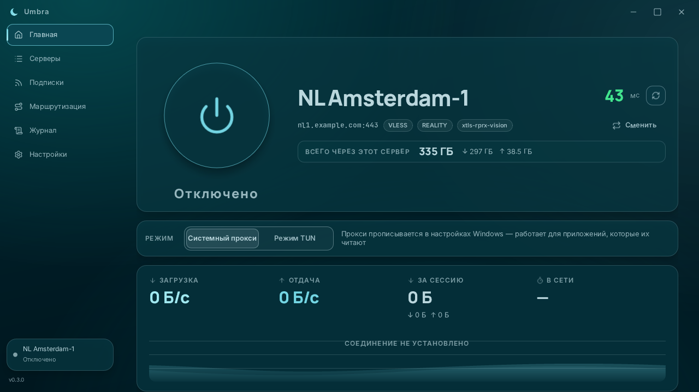

# Umbra

**Native Windows networking client built with Rust and Slint.** Umbra manages Mihomo and sing-box, with subscription import, system proxy and TUN modes, and rules for routing by process, domain, or IP/CIDR.

[Download for Windows](https://github.com/wannasly/Umbra/releases/latest) · [CI](https://github.com/wannasly/Umbra/actions/workflows/ci.yml) · [Документация на русском](README.ru.md)



## Install and connect

1. Download the x64 installer or portable ZIP for Windows 10 or 11. The release bundles both cores and includes `SHA256SUMS.txt`. The builds are unsigned.
2. Import a provider subscription or a supported server link, then select a server. VLESS, Reality, and Hysteria2 support depends on the selected core and configuration. sing-box does not support xHTTP.
3. Select the core in Settings and connect in system proxy or TUN mode. TUN requires administrator privileges.
4. Use the [routing screen](docs/images/native/routing-1280x720.png) to add Proxy, Direct, or Block rules. Reconnect to apply changes to an active connection.

Quit Umbra from the tray before updating. Profiles are retained under `%APPDATA%/com.umbra.proxy`.

## Engineering notes

- **Native UI.** Slint replaced the Tauri/React frontend while retaining the Rust backend and existing profile format. FemtoVG handles rendering on compatible drivers, with a software fallback for basic Windows drivers. See the [migration notes and measurement setup (Russian)](docs/NATIVE_UI.ru.md).
- **Core lifecycle.** The Rust backend prepares configuration, launches the selected core, and manages Windows proxy state. It restores the previous system proxy settings on disconnect and supports recovery after a crash.
- **Packaging.** CI verifies checksums for pinned core archives. The release workflow builds and smoke-tests the installer and portable bundle. See [release notes for v0.3.2](docs/RELEASE_v0.3.2.md).

## Build and test

Use Rust stable with the Windows MSVC toolchain, Visual Studio Build Tools, and the Windows SDK. Place the desired core executable in `src-tauri/resources/` before building a bundled executable. The directory name dates to the original Tauri app. The native build uses Cargo directly.

```powershell
cargo fmt --all -- --check
cargo test --workspace --locked
cargo clippy --workspace --all-targets --all-features --locked -- -D warnings
cargo build --release --locked
```

Run `target/release/umbra.exe`. To build an installer and portable archive, install NSIS, place both cores in `src-tauri/resources/`, and run `./scripts/package.ps1`. See the [testing guide (Russian)](docs/TESTING.ru.md) for runtime, visual, and packaging checks.

[MIT license](LICENSE) · [Third-party notices](THIRD_PARTY_NOTICES.md) · [Security reporting](SECURITY.md) · [Privacy notes (Russian)](docs/PRIVACY.ru.md)
