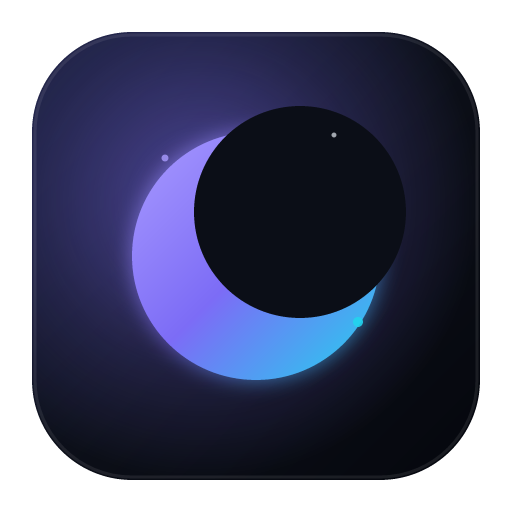

<h1>Umbra</h1>

Нативный Windows-клиент для sing-box: Rust + Slint, без WebView2.

## Возможности

- VLESS, TLS/Reality, Hysteria2; импорт ссылок и конфигураций.
- Подписки: обновление по расписанию, квоты, HWID, кабинет и поддержка провайдера.
- Системный прокси с восстановлением прежних настроек после отключения или сбоя.
- TUN; маршруты процессов, доменов и IP/CIDR; действия Proxy / Direct / Block.
- Избранное, поиск, сортировка, задержка, статистика и журнал.
- Трей, повторный запуск, автозапуск, русский и английский интерфейс.

Дизайн перенесён из исходной Umbra: палитра, Inter / Manrope / JetBrains Mono, круг подключения, панели и расположение элементов. Профили и настройки прежней версии используются из %APPDATA%/com.umbra.proxy.

## Скачать

Откройте [релизы](https://github.com/wannasly/Umbra/releases):

- Umbra_&lt;version&gt;_x64-setup.exe — установщик для текущего пользователя.
- Umbra_&lt;version&gt;_windows_x64_portable.zip — приложение и ядро без установки.
- SHA256SUMS.txt — контрольные суммы файлов.

Требуется Windows 10/11 x64. WebView2 и Node.js для запуска не нужны. sing-box 1.13.14 входит в сборку. Для TUN нужны права администратора. При обновлении завершите Umbra через меню трея. Установщик и удаление приложения сохраняют пользовательские профили.

Сборки не подписаны коммерческим сертификатом. SHA-256 проверяет целостность файла, но не заменяет цифровую подпись.

## Быстрый старт

1. Добавьте подписку провайдера или импортируйте ссылки VLESS / Hysteria2.
2. Выберите узел на странице «Серверы».
3. Выберите системный прокси или TUN и нажмите кнопку подключения.
4. Добавьте правила в разделе «Маршрутизация». После изменения правил активного соединения выполните переподключение.

xHTTP не поддерживается sing-box; такие узлы пропускаются с сообщением об ошибке импорта.

## Ресурсы

Локальный замер 23.10.2026: release-сборки, окно 1280×720 логических пикселей, отключённое соединение, одинаковые тестовые профили, 30 секунд после прогрева. У Tauri учтено всё дерево процессов WebView2. CPU — процент всей машины с 16 логическими процессорами.

Slint в этом замере использует FemtoVG. На базовом видеодрайвере без нужной поддержки OpenGL приложение автоматически выбирает программный рендер; его расход может отличаться.

| Метрика в простое | Tauri + React 0.2.5 | Rust + Slint |
| --- | ---: | ---: |
| Приватный рабочий набор RAM | 205,44 МиБ | 63,80 МиБ |
| Общий рабочий набор процессов | 485,31 МиБ | 114,85 МиБ |
| CPU | 10,427% | 0,009% |
| Загрузка GPU, сумма движков | 2,59% | 0% в выборке |
| Видеопамять, dedicated + shared | 72,29 МиБ | 81,86 МиБ |

Приватная RAM в этом сценарии ниже примерно на 69%. Видеопамяти Slint потребляет немного больше. Это измерение одного компьютера и сценария, а не гарантия для любых систем. При подключении расход ядра sing-box учитывается отдельно. [Архитектура и методика](docs/NATIVE_UI.ru.md).

В простое UI не запрашивает непрерывные кадры. Фон и декоративная волна статичны; переходы элементов управления сохранены. Списки виртуализированы, журнал ограничен 2000 строками, фоновые события объединяются перед обновлением UI.

## Сборка

Нужны Rust stable, MSVC Build Tools и Windows SDK. Для установщика дополнительно нужен NSIS. Положите официальный sing-box.exe 1.13.14 в src-tauri/resources/ либо используйте GitHub Actions: он скачивает архив и проверяет SHA-256.

~~~powershell
cargo test --workspace --locked
cargo build --release --locked
./scripts/package.ps1
~~~

Приложение появится в target/release/umbra.exe, установщик и portable-архив — в release/. При другом расположении NSIS передайте параметр -MakeNsis с путём к makensis.exe.

Release workflow собирает Windows-приложение и установщик в GitHub Actions и прикладывает файлы с контрольными суммами к тегу v*. npm и Tauri CLI для новой сборки не используются. Историческое имя каталога src-tauri сохранено для переноса бэкенда.

[Инструкция тестирования](docs/TESTING.ru.md). Исходная Tauri-версия сохранена в истории и [теге v0.2.5](https://github.com/wannasly/Umbra/tree/v0.2.5).

## Приватность и лицензии

Umbra не использует аналитику, рекламу или телеметрию. Данные остаются локальными; подписка обновляется через указанный URL провайдера. HWID передаётся только при включённой настройке. [Приватность](docs/PRIVACY.ru.md), [безопасность](SECURITY.md).

Код Umbra — [MIT](LICENSE). Для Slint, шрифтов, иконок, флагов и отдельного sing-box действуют собственные лицензии: [THIRD_PARTY_NOTICES.md](THIRD_PARTY_NOTICES.md), каталог licenses/.
